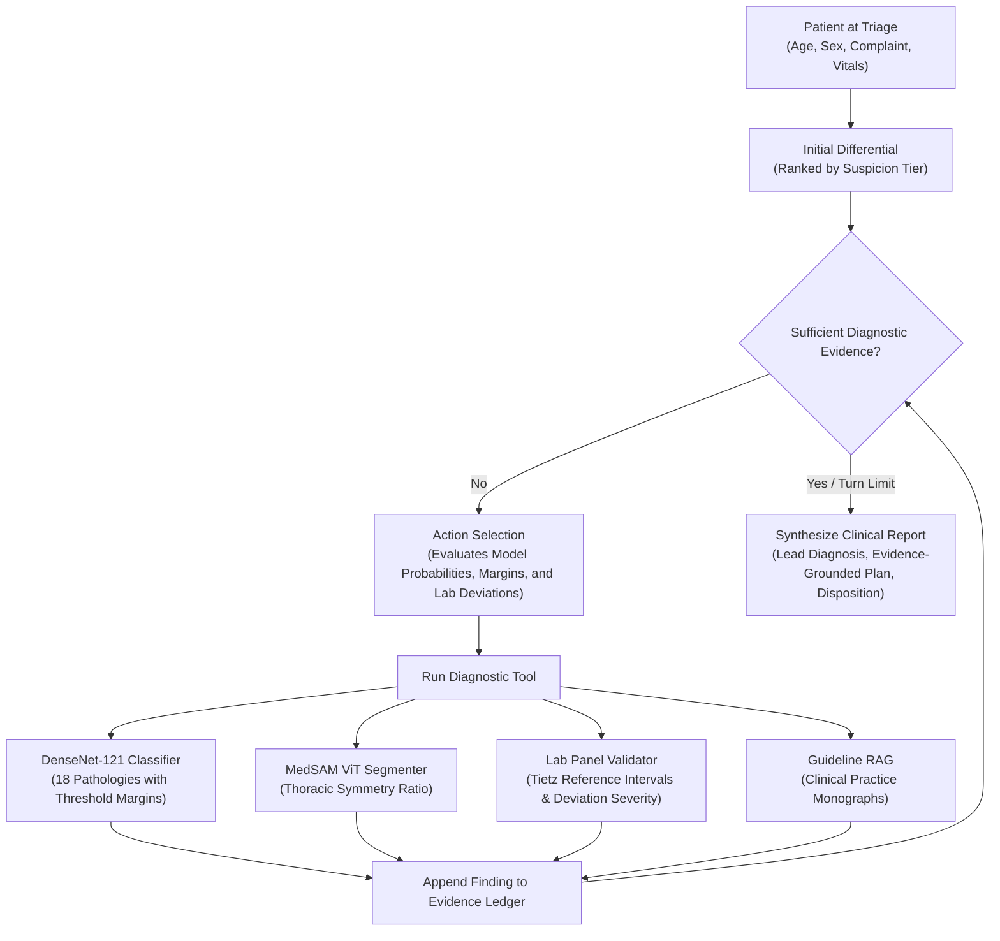

<<<<<<< HEAD
# Better Clinical Agentic AI framework
=======
# Towards Reliable Tool Orchestration and Evidence Coordination in Open-World Multimodal Clinical Agent Systems
>>>>>>> 35699a8 (Upload Codebase)

A clinical diagnostic AI agent built for active, sequential patient workups. Instead of evaluating patient records in a single prompt, the system mirrors hospital emergency workflows: starting from initial vitals and complaints, ordering targeted investigations step-by-step, running vision models and laboratory validators, and cross-checking decisions against clinical guidelines.

---

## Technical Report

The complete 8-page academic paper detailing the system architecture, mathematical formulations, diagnostic evaluation, and an end-to-end clinical case trace with embedded radiograph imagery is available in `docs/`:

- **PDF**: [`docs/CLINICAL_AGENT_REPORT.pdf`](docs/CLINICAL_AGENT_REPORT.pdf)
- **LaTeX Source**: [`docs/CLINICAL_AGENT_REPORT.tex`](docs/CLINICAL_AGENT_REPORT.tex)

---

## How It Works

Standard medical benchmarks feed entire patient files (scans, full lab panels, and notes) to an LLM all at once. In actual hospital practice, clinicians work sequentially. They review presenting symptoms, build a differential, and order tests one at a time based on what earlier tests showed.



The system executes this process across distinct stages:

1. **Intake and Differential Formulation**: The attending language model parses demographics, symptoms, and vitals to formulate an initial list of 3 to 5 candidate conditions (`HIGH_SUSPICION`, `MODERATE_SUSPICION`, `RULE_OUT`).
2. **Sequential Tool Selection**: At each turn, the agent evaluates the evidence collected so far. It inspects model classification margins ($|p_k - \theta_k|$) and lab deviations to pick the most informative next test.
3. **Specialist Model Execution**: The selected tool runs directly on the patient case data, returning quantitative metrics and structured findings.
4. **Guideline Verification via RAG**: Proposed treatments and diagnostic suspicions are matched against indexed society guidelines (IDSA, ATS, AHA, ACC, ESC, NIH) using TF-IDF cosine similarity.
5. **Report Synthesis**: When the agent has enough evidence (or hits the 4-turn limit), it generates a final consultation report with the primary diagnosis, clinical impression, actionable treatment plan, and disposition (`ADMIT_INPATIENT`, `DISCHARGE_WITH_FOLLOWUP`, `ESCALATE_TO_PHYSICIAN`).

---

## Diagnostic Tools and Deep Learning Checkpoints

The agent coordinates real specialist tools without mock fallbacks:

- **Chest X-Ray Classifier (`ChestXRayClassifierTool`)**:
  - *Model*: 121-layer DenseNet (`DenseNet-121`) from `TorchXRayVision` (`densenet121-res224-all`).
  - *Details*: Calculates calibrated probabilities and explicit operating margins ($\text{Margin} = |p_k - \theta_k|$) across 18 chest pathologies (consolidation, cardiomegaly, effusion, pneumothorax, infiltration, and others).
- **Thoracic Anatomical Segmenter (`MedSAMSegmenterTool`)**:
  - *Model*: Medical Segment Anything Model (`wanglab/medsam-vit-base`) Vision Transformer.
  - *Details*: Prompts bounding boxes over the hemithoraces to segment both lung fields and calculate the symmetry ratio $\mathcal{S} = \frac{\min(A_L, A_R)}{\max(A_L, A_R)}$. Values under 0.85 indicate volume loss or dense unilateral consolidation.
- **Laboratory Panel Validator (`LaboratoryTestsTool`)**:
  - *Reference*: Uses standard physiological reference intervals from the *Tietz Textbook of Clinical Chemistry*.
  - *Details*: Evaluates complete blood count, inflammatory markers (Procalcitonin, CRP), cardiac markers (Troponin I, BNP, NT-proBNP), coagulation (D-Dimer), and basic metabolic panels, calculating quantitative percentage deviations ($\Delta = \frac{|v - \lambda|}{\lambda}$).
- **Guideline Retrieval RAG (`MedicalKnowledgeRAGTool`)**:
  - *Details*: Uses MedRAG clinical concept mapping and TF-IDF cosine similarity against indexed disease monographs and practice guidelines, grounding treatment decisions in published medical protocols.
- **Clinical Notes Extractor (`ClinicalNotesExtractorTool`)**:
  - *Details*: Regex-based triage parser that extracts documented physical signs (crackles, jugular venous distension, point tenderness, relative bradycardia).

---

## Benchmark Evaluation Results

The evaluation suite (`src/clinical_agent/evaluation/sample_cases.py`) covers 8 diverse clinical presentations sourced from open-access hospital datasets (NIH ChestX-ray14, IEEE CXR, and emergency medicine records).

All 8 cases evaluate sequentially with full evidence grounding:

| Case ID | Etiology & Presentation | Key Findings | Agent Diagnosis | Disposition |
|---|---|---|---|---|
| `PT_STREP_65M` | Typical Pneumococcal CAP | Dense RUL Opacity, PCT 1.85 ug/L, WBC 17.8 | Bacterial Pneumonia | `ADMIT_INPATIENT` |
| `PT_ADHF_71M` | Acute Decompensated Heart Failure | BNP 1680 pg/mL, Cardiomegaly, JVD | Decompensated HF | `ADMIT_INPATIENT` |
| `PT_PE_48F` | Acute Pulmonary Embolism | D-Dimer 3.85 ug/mL, Clear CXR, Calf swelling | Pulmonary Embolism | `ADMIT_INPATIENT` |
| `PT_COSTO_34M` | Costochondritis / Chest Wall Strain | Parasternal point tenderness, Normal labs & CXR | Costochondritis | `DISCHARGE_WITH_FOLLOWUP` |
| `PT_PJP_HIV_40M` | PJP Pneumonia in HIV Host | SpO2 84%, CD4 85, Perihilar haziness | PJP Pneumonia | `ADMIT_INPATIENT` |
| `PT_KLEB_DM_62F` | Klebsiella Necrotizing Pneumonia | Currant-jelly sputum, Upper lobe cavitation, WBC 21.4 | Klebsiella Pneumonia | `ADMIT_INPATIENT` |
| `PT_LEGIONELLA_60M` | Legionnaires' Disease | Hyponatremia (Na 126), Watery diarrhea, Faget sign | Legionnaires' Disease | `ADMIT_INPATIENT` |
| `PT_COVID_VIRAL_58M` | COVID-19 Acute Viral Infection | Anosmia, Bilateral ground-glass opacities, CRP 78 | COVID-19 Infection | `ADMIT_INPATIENT` |

---

## Academic References

1. **SDBench**: *A Benchmark for Sequential Diagnosis with Language Models* (Microsoft Research, 2025; [arXiv:2506.22405](https://arxiv.org/abs/2506.22405)).
2. **MedAgent-Pro**: *Towards Evidence-Based Multi-Modal Medical Diagnosis via Reasoning Agentic Workflow* (Wang et al., ICLR 2026; [arXiv:2503.18968](https://arxiv.org/abs/2503.18968)).
3. **MedRAX**: *A Medical Reasoning Agent for Chest X-ray* (Bo Wang Lab, 2025; [arXiv:2502.02618](https://arxiv.org/abs/2502.02618)).
4. **TorchXRayVision**: *A library of chest X-ray datasets and models* (Cohen et al., MIDL 2022; [arXiv:2111.00595](https://arxiv.org/abs/2111.00595)).
5. **MedSAM**: *Segment Anything in Medical Images* (Ma et al., Nature Communications 2024; [DOI:10.1038/s41467-024-44824-z](https://doi.org/10.1038/s41467-024-44824-z)).
6. **MedRAG**: *Benchmarking Retrieval-Augmented Generation for Medicine* (Xiong et al., ACL 2024; [arXiv:2402.13178](https://arxiv.org/abs/2402.13178)).
7. **Tietz Reference Intervals**: *Tietz Textbook of Clinical Chemistry and Molecular Diagnostics* (Rifai et al., 6th Edition, Elsevier, 2018).

---

## Quickstart

### 1. Environment Setup

```bash
git clone https://github.com/your-username/Better-Clinical-Agent.git
cd Better-Clinical-Agent

python -m venv .venv
source .venv/bin/activate  # On Windows: .venv\Scripts\activate

pip install -r requirements.txt
```

### 2. Configure the LLM

The framework connects via `LiteLLM` to local Ollama models (`medgemma`, `medllama2`) or cloud providers.

To run locally with MedGemma:
```bash
ollama pull medgemma
```

Settings can be changed in `settings.json` or by setting environment variables:
```bash
export LLM_MODEL="ollama/medgemma"
export LLM_TEMPERATURE="0.1"
```

### 3. Run the Tests

Execute the 14-test suite covering schemas, vision models, lab tools, RAG retrieval, and the LangGraph engine:

```bash
python -m pytest tests/ -v
```

### 4. Run the 8-Case Benchmark Runner

To evaluate all 8 benchmark cases sequentially:

```bash
python -m src.clinical_agent.evaluation.run_benchmark
```

### 5. Run the Interactive CLI Demo

Run a single case to see turn-by-turn tool calls and report generation:

```bash
# Case 0: Streptococcus pneumoniae Lobar Pneumonia
python demo_execution.py --case 0

# Case 1: Acute Decompensated Heart Failure
python demo_execution.py --case 1

# Case 2: Acute Pulmonary Embolism
python demo_execution.py --case 2

# Case 3: Costochondritis (Musculoskeletal Chest Pain)
python demo_execution.py --case 3

# Case 4: Pneumocystis jirovecii Pneumonia (HIV Patient)
python demo_execution.py --case 4

# Case 5: Klebsiella pneumoniae Necrotizing Pneumonia
python demo_execution.py --case 5

# Case 6: Legionnaires' Disease
python demo_execution.py --case 6

# Case 7: COVID-19 Viral Respiratory Infection
python demo_execution.py --case 7
```

To run through the compiled **LangGraph state machine**:

```bash
python demo_execution.py --case 0 --graph
```

---

## Repository Layout

```
.
├── src/
│   └── clinical_agent/
│       ├── schemas.py              # Pydantic data models for cases, findings, and reports
│       ├── config.py               # Runtime settings and model configurations
│       ├── llm_client.py           # LiteLLM client with structured JSON parsing
│       ├── agent.py                # Attending clinical agent sequential loop
│       ├── graph.py                # Compiled LangGraph state machine
│       ├── models/
│       │   ├── densenet_cxr.py     # TorchXRayVision DenseNet-121 wrapper
│       │   └── medsam_wrapper.py   # MedSAM ViT-Base segmentation wrapper
│       ├── tools/
│       │   ├── base.py             # Specialist tool base interface
│       │   ├── chest_xray.py       # Radiograph classifier with threshold margins
│       │   ├── medsam.py           # Thoracic lung area segmenter & symmetry ratio
│       │   ├── laboratory.py       # Lab biomarker validator with deviation metrics
│       │   ├── medical_knowledge.py# Guideline retrieval tool (MedRAG style)
│       │   └── clinical_notes.py   # Triage note and physical exam parser
│       ├── prompts/
│       │   └── __init__.py         # Differential, action, and report prompts
│       └── evaluation/
│           ├── sample_cases.py     # 8 benchmark clinical cases
│           ├── simulated_ehr.py    # Multi-turn EHR simulation environment
│           └── run_benchmark.py    # Automated benchmark runner
├── tests/                          # 14 pytest unit and integration tests
├── demo_execution.py               # Interactive CLI demo script
├── data/sample_images/             # Radiographic images from NIH and IEEE datasets
├── docs/
│   ├── CLINICAL_AGENT_REPORT.pdf   # 8-page compiled technical report PDF
│   ├── CLINICAL_AGENT_REPORT.tex   # LaTeX report source
│   └── cxr_case0_streptococcus.jpg # Radiograph asset for Case 0
├── pytest.ini                      # Pytest configuration
├── settings.json                   # Runtime configuration
└── IMPLEMENTATION_LOG.md           # Implementation and change log
```

---

## Authors & Contact

- **Prabhu Nandan** (Author) — `prabhusahu23@iiserb.ac.in`
- **Dr. Shreya Goyal** (Instructor / Supervisor) — `shreyagoyal@iitmandi.ac.in`

---

## License

This project is licensed under the MIT License. See the [LICENSE](LICENSE) file for details.
