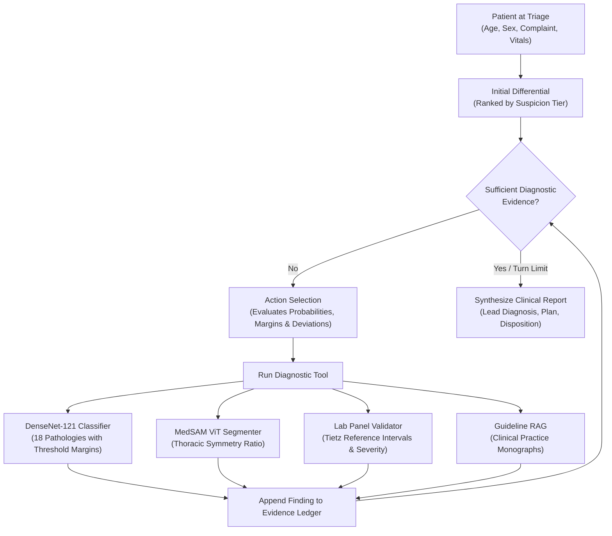

# Towards Reliable Tool Orchestration and Evidence Coordination in Open-World Multimodal Clinical Agent Systems

A clinical diagnostic AI agent built for active, sequential patient workups. Instead of evaluating patient records in a single prompt, the system mirrors hospital emergency workflows: starting from initial vitals and complaints, ordering targeted investigations step-by-step, running vision models and laboratory validators, and cross-checking decisions against clinical guidelines.

---

## Technical Report & Implementation Records

The complete academic report detailing the system architecture, mathematical formulations, diagnostic evaluation, and clinical case trace is available in `docs/`:

- **Academic Paper (PDF)**: [`docs/CLINICAL_AGENT_REPORT.pdf`](docs/CLINICAL_AGENT_REPORT.pdf)
- **Live Diagnostic Trace (Case 5)**: [`docs/demo_case5.md`](docs/demo_case5.md) *(Complete turn-by-turn trace with neural model outputs, lab deviations, and guideline RAG)*
- **Implementation Log**: [`IMPLEMENTATION_LOG.md`](IMPLEMENTATION_LOG.md)
- **Medical RAG design**: [`docs/RAG_PIPELINE.md`](docs/RAG_PIPELINE.md)


---

## How It Works

Standard medical benchmarks feed entire patient files (scans, full lab panels, and notes) to an LLM all at once. In actual hospital practice, clinicians work sequentially. They review presenting symptoms, build a differential, and order tests one at a time based on what earlier tests showed.

<div align="center">



</div>


The system executes this process across distinct stages:

1. **Intake and Differential Formulation**: The attending language model parses demographics, symptoms, and vitals to formulate an initial list of 3 to 5 candidate conditions (`HIGH_SUSPICION`, `MODERATE_SUSPICION`, `RULE_OUT`).
2. **Sequential Tool Selection**: At each turn, the agent evaluates the evidence collected so far. It inspects model classification margins ($|p_k - \theta_k|$) and lab deviations to pick the most informative next test.
3. **Specialist Model Execution**: The selected tool runs directly on the patient case data, returning quantitative metrics and structured findings.
4. **Knowledge Retrieval**: Queries go to a hybrid medical retriever (BM25 + MedCPT + cross-encoder) over ~427k passages from 18 medical textbooks and StatPearls; see [Medical RAG](#medical-rag-ddx-rag) below.
5. **Report Synthesis**: When the agent has enough evidence (or hits the 4-turn limit), it generates a final consultation report with the primary diagnosis, clinical impression, actionable treatment plan, and disposition (`ADMIT_INPATIENT`, `DISCHARGE_WITH_FOLLOWUP`, `ESCALATE_TO_PHYSICIAN`).

---

## Diagnostic Tools and Deep Learning Checkpoints

The agent coordinates real specialist tools alongside direct LLM clinical intake:

- **Direct LLM Clinical Intake & Pertinent Negatives Ledger**:
  - *Details*: The Attending LLM directly ingests unstructured clinical notes, triage history, and clinical shorthand, synthesizing structured pertinent positives (confirmed present) and pertinent negatives (denied or normal on exam) directly into the Evidence Ledger.
- **Chest X-Ray Classifier (`ChestXRayClassifierTool`)**:
  - *Model*: 121-layer DenseNet (`DenseNet-121`) from `TorchXRayVision` (`densenet121-res224-all`).
  - *Details*: Uses TorchXRayVision's operating-point calibrated outputs (0.5 = the per-label operating threshold chosen on validation data); a label is reported positive at >= 0.5. Labels the checkpoint was not trained on are dropped.
- **Thoracic Anatomical Segmenter (`MedSAMSegmenterTool`)**:
  - *Model*: Medical Segment Anything Model (`wanglab/medsam-vit-base`) Vision Transformer.
  - *Details*: Performs multi-prompt anatomical segmentation of bilateral hemithoraces and the cardiac silhouette to extract objective spatial biomarkers:
    1. **Cardiothoracic Ratio (CTR)**: Calculates transverse cardiac vs. thoracic diameter ($\text{CTR} = \frac{D_{\text{heart}}}{D_{\text{thorax}}}$), providing quantitative verification of cardiomegaly ($\text{CTR} > 0.50$).
    2. **Unilateral Lung Volume Deficit / Collapse %**: Quantifies parenchymal loss in pneumothorax, effusion, or lobar atelectasis ($\text{Deficit} = (1.0 - \mathcal{S}) \times 100\%$).

- **Laboratory Panel Validator (`LaboratoryTestsTool`)**:
  - *Reference*: Uses standard physiological reference intervals from the *Tietz Textbook of Clinical Chemistry*.
  - *Details*: Evaluates complete blood count, inflammatory markers (Procalcitonin, CRP), cardiac markers (Troponin I, BNP, NT-proBNP), coagulation (D-Dimer), and basic metabolic panels, calculating quantitative percentage deviations ($\Delta = \frac{|v - \lambda|}{\lambda}$).
- **Guideline Retrieval RAG (`MedicalKnowledgeRAGTool`)**:
  - *Details*: Thin wrapper over the hybrid retriever (`src/clinical_agent/retrieval/`), returning cited passages (snippet ids) from Textbooks + StatPearls.


---

## Medical RAG (DDx-RAG)

The knowledge layer is a real retrieval system, evaluated on a public benchmark against published methods. Full design, failure modes and fixes: [`docs/RAG_PIPELINE.md`](docs/RAG_PIPELINE.md).

- **Corpora:** 18 USMLE textbooks + StatPearls (~427k passages), the same corpora as MedRAG / i-MedRAG.
- **Retriever:** BM25 ∥ MedCPT (exact FAISS) → Reciprocal Rank Fusion → MedCPT cross-encoder → per-query quotas, de-duplication, neighbour-paragraph expansion.
- **DDx-RAG (ours):**
  1. Form a differential from the question alone.
  2. Retrieve evidence that would **support, discriminate or refute** each hypothesis.
  3. Fact-check the hypotheses with mandatory citations.
  4. Let evidence overturn the model's closed-book answer only when it is cited. Verification depth is set by how much the model's own samples disagree.
- **Benchmark:** MIRAGE (MedQA-US, MMLU-Med) with Llama-3.1-8B. Every baseline (CoT, self-consistency, MedRAG, RAG²-style, i-MedRAG) is rerun in the same setup. Results include paired McNemar tests, fixed/broke counts, cost per question, ablations and robustness tests.
- **Results:** pending the GPU runs (see [`docs/RUNNING_BENCHMARKS.md`](docs/RUNNING_BENCHMARKS.md)).

### Demo cases

`src/clinical_agent/evaluation/sample_cases.py` holds 11 hand-written cases (8 typical + 3 stress tests). They are useful for demos and traces. **They are not a benchmark:** they were written by the author, and the earlier "8/8 correct" relied on a toy retrieval index built with the same keywords (see the Nov 2026 entries in `IMPLEMENTATION_LOG.md`). Interactive diagnosis will be benchmarked on DDXPlus.

---

## Literature Surveys & Research Progression

The foundational literature reviews, failure-mode audits, and taxonomy breakdowns are documented in `docs/survey/`:

| Document | Topic and Research Scope |
|---|---|
| [`01_landscape_survey_ai_agents_in_healthcare.md`](docs/survey/01_landscape_survey_ai_agents_in_healthcare.md) | Shift from static LLM question answering toward modality-driven clinical agents. |
| [`02_clinical_agent_taxonomy_20_categories.md`](docs/survey/02_clinical_agent_taxonomy_20_categories.md) | Operational taxonomy organizing over 300 papers across 20 distinct healthcare domains. |
| [`03_multimodal_clinical_agents_gap_analysis.md`](docs/survey/03_multimodal_clinical_agents_gap_analysis.md) | Critical analysis of 27 multimodal clinical agents and 11 documented failure modes. |
| [`04_evidence_reliable_coordination_survey.md`](docs/survey/04_evidence_reliable_coordination_survey.md) | Review of systems including AgentRx, MedAgentBoard, MDAgents, CARE, CoMMa, and Cerebra. |
| [`05_erc_framework_strengths_and_flaws_assessment.md`](docs/survey/05_erc_framework_strengths_and_flaws_assessment.md) | Stress testing evidence coordination mechanisms and identifying system vulnerabilities. |
| [`06_erc_vulnerability_fix_notes.txt`](docs/survey/06_erc_vulnerability_fix_notes.txt) | Architectural strategies for preventing premature diagnostic closure and missing data errors. |
| [`07_sota_clinical_mas_comparison_matrix.md`](docs/survey/07_sota_clinical_mas_comparison_matrix.md) | Side-by-side comparison matrix across multi-agent systems, uncertainty handling, and modalities. |
| [`08_medagent_pro_lineage_and_verification_survey.md`](docs/survey/08_medagent_pro_lineage_and_verification_survey.md) | Analysis of planning structures, step-level verification, and execution bottlenecks. |
| [`09_deep_read_pass_medvqa_deeprare_confagents.md`](docs/survey/09_deep_read_pass_medvqa_deeprare_confagents.md) | Deep analysis of Med-VQA, DeepRare, ConfAgents, and clinical decision boundaries. |
| [`10_medagent_pro_disc_haemorrhage_failure_analysis.md`](docs/survey/10_medagent_pro_disc_haemorrhage_failure_analysis.md) | Case study on downstream diagnostic collapse caused by degraded specialist indicators. |

Supporting materials include:
- **Modality Ingestion Breakdowns**: [`docs/survey/phase_breakdowns/`](docs/survey/phase_breakdowns/)
- **Paper Database & Catalog**: [`paper_catalog/`](paper_catalog/README.md) (indexed spreadsheet and annotated reference list)
- **Research Progress Tracker**: [`docs/progress_tracker.md`](docs/progress_tracker.md)

---

## Chronological Presentation Series

Slide decks, PDF summaries, and notes prepared across project milestones are archived in `docs/presentations/`:

| Folder | Presentation Deck | Focus Area |
|---|---|---|
| [`1/`](docs/presentations/1/) | The Clinical Circuit Blueprint (EHR) | EHR data parsing, clinical circuits, and structured records. |
| [`2/`](docs/presentations/2/) | Medical Agentic Ingestion Architectures | Multi-agent intake pipelines and modality routing. |
| [`3/`](docs/presentations/3/) | Omni-Modal Synthesis | Early versus late multimodal feature fusion. |
| [`4/`](docs/presentations/4/) | Clinical AI Reality Check | Evaluation of clinical readiness and real-world failure cases. |
| [`5/`](docs/presentations/5/) | MultiModal Clinical Agents Presentation | Deep review of 27 state-of-the-art multimodal diagnostic papers. |
| [`6/`](docs/presentations/6/) | Agentic AI in Healthcare Deck | Project defense synthesis and evidence coordination architecture. |
| [`misc/`](docs/presentations/misc/) | Decks, Transcripts & Web Viewer | Presentation notes, full-text transcripts, and HTML slide viewer. |

A detailed directory index is provided in [`docs/presentations/README.md`](docs/presentations/README.md).

---

## Academic References

1. **SDBench**: *A Benchmark for Sequential Diagnosis with Language Models* (Microsoft Research, 2025; [arXiv:2506.22405](https://arxiv.org/abs/2506.22405)).
2. **MedAgent-Pro**: *Towards Evidence-Based Multi-Modal Medical Diagnosis via Reasoning Agentic Workflow* (Wang et al., ICLR 2026; [arXiv:2503.18968](https://arxiv.org/abs/2503.18968)).
3. **MedRAX**: *A Medical Reasoning Agent for Chest X-ray* (Bo Wang Lab, 2025; [arXiv:2502.02618](https://arxiv.org/abs/2502.02618)).
4. **TorchXRayVision**: *A library of chest X-ray datasets and models* (Cohen et al., MIDL 2022; [arXiv:2111.00595](https://arxiv.org/abs/2111.00595)).
5. **MedSAM**: *Segment Anything in Medical Images* (Ma et al., Nature Communications 2024; [DOI:10.1038/s41467-024-44824-z](https://doi.org/10.1038/s41467-024-44824-z)).
6. **MedRAG**: *Benchmarking Retrieval-Augmented Generation for Medicine* (Xiong et al., ACL 2024; [arXiv:2402.13178](https://arxiv.org/abs/2402.13178)).
7. **Tietz Reference Intervals**: *Tietz Textbook of Clinical Chemistry and Molecular Diagnostics* (Rifai et al., 6th Edition, Elsevier, 2018).

---

## Quickstart

### 1. Environment Setup

```bash
git clone https://github.com/your-username/Better-Clinical-Agent.git
cd Better-Clinical-Agent

python -m venv .venv
source .venv/bin/activate  # On Windows: .venv\Scripts\activate

pip install -r requirements.txt
```

### 2. Configure the LLM

All LLM calls go through one OpenAI-compatible client (`src/clinical_agent/llm.py`), so any of these work:
- vLLM (used for the benchmarks): `bash scripts/serve_vllm.sh`
- Ollama: `LLM_BASE_URL=http://localhost:11434/v1`
- llama.cpp server

Put the settings in `.env`:

```bash
LLM_BASE_URL=http://localhost:8000/v1
LLM_MODEL=llama31-8b
DATA_DIR=/path/to/data      # corpora + indexes (~8 GB)
```

### 3. Run the Tests

```bash
python -m pytest tests/ -q        # retrieval, RAG methods and stats tests run on CPU without models
```

### 4. Build the Knowledge Index and Run MIRAGE

```bash
python scripts/build_index.py download --corpora textbooks statpearls
python scripts/build_index.py build --corpora textbooks statpearls
python scripts/run_mirage.py --dataset medqa --methods cot medrag dx_agent --set final=select
```

Full instructions, ablations and robustness runs: [`docs/RUNNING_BENCHMARKS.md`](docs/RUNNING_BENCHMARKS.md).

### 5. Interactive CLI Demonstration

Run a single case to see turn-by-turn tool calls and report generation:

```bash
# Case 0: Streptococcus pneumoniae Lobar Pneumonia
python demo_execution.py --case 0

# Case 1: Acute Decompensated Heart Failure
python demo_execution.py --case 1

# Case 2: Acute Pulmonary Embolism
python demo_execution.py --case 2

# Case 3: Costochondritis (Musculoskeletal Chest Pain)
python demo_execution.py --case 3

# Case 4: Pneumocystis jirovecii Pneumonia (HIV Patient)
python demo_execution.py --case 4

# Case 5: Klebsiella pneumoniae Necrotizing Pneumonia
python demo_execution.py --case 5

# Case 6: Legionnaires' Disease
python demo_execution.py --case 6

# Case 7: COVID-19 Viral Respiratory Infection
python demo_execution.py --case 7
```

The agent runs as a **LangGraph state machine** (intake → choose → run tool → … → report);
the demo prints every step as it happens.

---

## Repository Layout

```
src/clinical_agent/
├── config.py               # settings from env / .env
├── llm.py                  # one OpenAI-compatible LLM client (+ JSON / answer parsing)
├── retrieval/
│   ├── corpus.py           # Textbooks + StatPearls download, chunking, in-memory store
│   ├── indexes.py          # BM25, MedCPT + FAISS, MedCPT cross-encoder
│   ├── search.py           # hybrid search, RRF, rerank, quotas, dedupe, neighbour expansion
│   └── evidence_tool.py    # the diagnostic agent's claim checker (sentence-level evidence cards)
├── rag/
│   ├── prompts.py          # baseline prompts (verbatim from MedRAG)
│   ├── methods.py          # cot, cot_sc, medrag, rationale_rag, imedrag
│   ├── agent.py            # DxAgent: options-free diagnostic agent (verify, critique, answer)
│   └── agent_prompts.py    # its prompts
├── evaluation/
│   ├── mirage.py           # MIRAGE loader, resumable runner, comparison table
│   ├── stats.py            # Wilson interval, exact McNemar test
│   └── sample_cases.py     # 11 demo cases for the agent
├── agent.py                # clinical agent: LangGraph state machine over the tools
├── clinical_prompts.py     # its prompts (intake, next test, report)
├── tools/                  # chest X-ray (DenseNet), MedSAM segmentation, labs, medical library
└── schemas.py              # Pydantic data classes
scripts/                    # build_index.py, run_mirage.py, analyze_results.py, serve_vllm.sh
docs/PROJECT_WALKTHROUGH.md # the whole project explained, file by file
docs/RAG_PIPELINE.md        # historical: the first RAG design (DDx-RAG v1)
docs/RUNNING_BENCHMARKS.md  # how to run everything on the GPU server
tests/                      # CPU-only unit tests (fake LLM, toy corpus)
IMPLEMENTATION_LOG.md       # dated log, including the audit of v2
```

---

## Authors & Contact

- **Prabhu Nandan** (Author): `prabhusahu23@iiserb.ac.in` — Indian Institute of Science Education and Research (IISER) Bhopal
- **Vanshika Gupta** (Author): `vanshikag23@iiserb.ac.in` — Indian Institute of Science Education and Research (IISER) Bhopal
- **Dr. Shreya Goyal** (Instructor / Supervisor): `shreyagoyal@iitmandi.ac.in` — Indian Institute of Technology (IIT) Mandi


---

## License

This project is licensed under the MIT License. See the [LICENSE](LICENSE) file for details.
