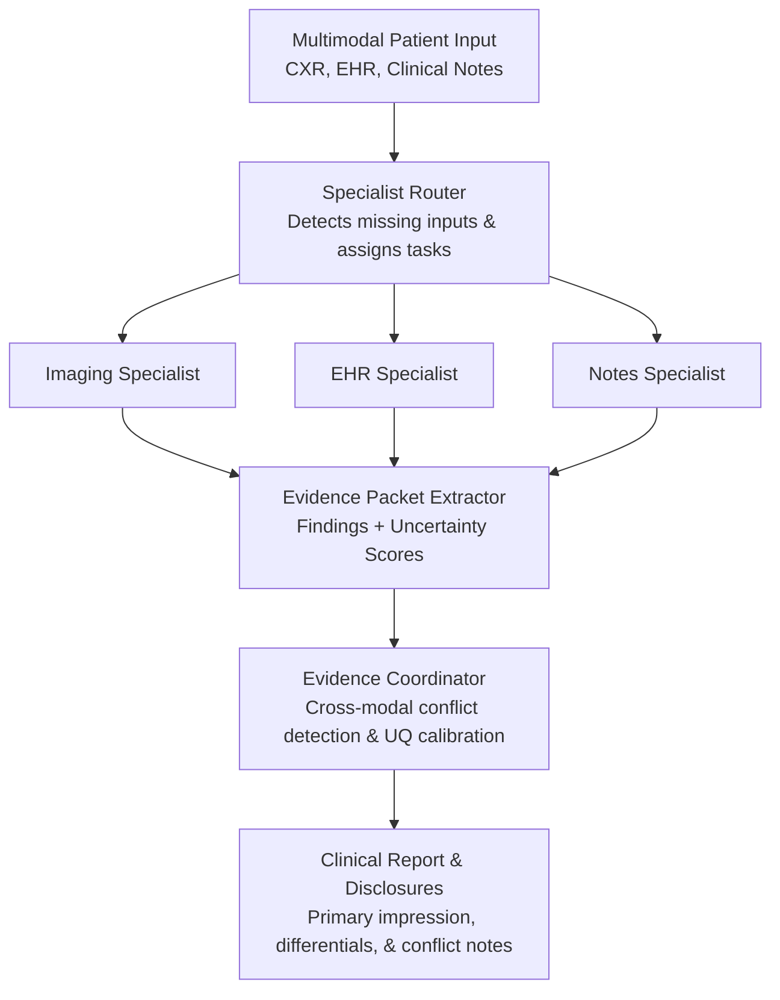

# Better Clinical Agentic AI framework

> **Evidence-Reliable Multimodal AI Reasoning for Healthcare**
>
> A modular framework and research benchmark designed to address key reliability, calibration, and missing-modality challenges in clinical multi-agent AI systems.

---

## Executive Overview

Deploying AI agents in healthcare requires more than fluency; it demands **epistemic reliability**—knowing which claims are load-bearing, detecting tool degradation, managing missing modalities, and preserving diagnostic uncertainty without forcing overconfident consensus.

This repository consolidates an extensive **300+ paper literature survey**, a critical analysis of **27 state-of-the-art multimodal clinical agents**, **11 systemic failure modes** identified across published benchmarks, a **6-deck presentation defense series**, and a streamlined Python software architecture (`src/clinical_agent/`) for building evidence-grounded clinical agents.

---

## Literature Surveys & Research Progression

Our research is organized in chronological progression, with self-explanatory document names detailing specific research milestones:

| Document | Focus & Research Significance |
|---|---|
| [`01_landscape_survey_ai_agents_in_healthcare.md`](docs/survey/01_landscape_survey_ai_agents_in_healthcare.md) | **Landscape Overview**: Paradigm shift toward modality-driven healthcare AI agents. |
| [`02_clinical_agent_taxonomy_20_categories.md`](docs/survey/02_clinical_agent_taxonomy_20_categories.md) | **20-Category Taxonomy**: Operational hierarchy framing 300+ papers across 20 domains. |
| [`03_multimodal_clinical_agents_gap_analysis.md`](docs/survey/03_multimodal_clinical_agents_gap_analysis.md) | **Category 1.1 Gap Analysis**: Critical analysis of 27 SOTA papers & **11 failure modes**. |
| [`04_evidence_reliable_coordination_survey.md`](docs/survey/04_evidence_reliable_coordination_survey.md) | **ERC Baseline Survey**: Evaluation of AgentRx, MedAgentBoard, MDAgents, CARE, CoMMa, & Cerebra. |
| [`05_erc_framework_strengths_and_flaws_assessment.md`](docs/survey/05_erc_framework_strengths_and_flaws_assessment.md) | **Critical Stress-Test**: Assessment of theoretical strengths and system vulnerabilities. |
| [`06_erc_vulnerability_fix_notes.txt`](docs/survey/06_erc_vulnerability_fix_notes.txt) | **Fix Notes**: Architectural mechanisms to prevent system vulnerabilities. |
| [`07_sota_clinical_mas_comparison_matrix.md`](docs/survey/07_sota_clinical_mas_comparison_matrix.md) | **Comparison Matrix**: SOTA clinical MAS feature comparison across UQ and missingness. |
| [`08_medagent_pro_lineage_and_verification_survey.md`](docs/survey/08_medagent_pro_lineage_and_verification_survey.md) | **MedAgent-Pro Lineage**: Workflow planning and step-level verification analysis. |
| [`09_deep_read_pass_medvqa_deeprare_confagents.md`](docs/survey/09_deep_read_pass_medvqa_deeprare_confagents.md) | **Deep-Read Pass**: Med-VQA, DeepRare, ConfAgents, and ethical framework boundaries. |
| [`10_medagent_pro_disc_haemorrhage_failure_analysis.md`](docs/survey/10_medagent_pro_disc_haemorrhage_failure_analysis.md) | **Indicator Failure Analysis**: Tool degradation impact (16.5 F1 score drop). |

- **Modality Ingestion Phases**: [`docs/survey/phase_breakdowns/`](docs/survey/phase_breakdowns/) (Perception, EHR, Imaging, Omics, RAG, Fusion, Omni-Modal).  
- **Database & Catalogs**: [`paper_catalog/`](paper_catalog/README.md) (Excel database & annotated master list).  
- **Progress Tracker**: [`docs/progress_tracker.md`](docs/progress_tracker.md) (Live status dashboard & milestone tracker).

---

## Chronological Presentation Series (`docs/presentations/`)

All presentation slide decks, PDF exports, transcripts, and defense notes created during the internship are organized in chronological order:

| Phase / Folder | Presentation Deck | Key Scope |
|---|---|---|
| [`1/`](docs/presentations/1/) | **The Clinical Circuit Blueprint (EHR)** (`.pptx`, `.pdf`) | EHR circuit design & structured data parsing. |
| [`2/`](docs/presentations/2/) | **Medical Agentic Ingestion Architectures** (`.pptx`) | Multi-agent ingestion pipeline design. |
| [`3/`](docs/presentations/3/) | **Omni-Modal Synthesis** (`.pptx`) | Omni-modal synthesis & early vs. late fusion. |
| [`4/`](docs/presentations/4/) | **Clinical AI Reality Check** (`.pptx`) | Empirical evaluation of SOTA clinical readiness. |
| [`5/`](docs/presentations/5/) | **MultiModal Clinical Agents Presentation** (`.pptx`) | Category 1.1 SOTA evaluation & 27 paper analysis. |
| [`6/`](docs/presentations/6/) | **Agentic AI in Healthcare Deck** (`.pptx`) | Comprehensive research defense & synthesis. |
| [`misc/`](docs/presentations/misc/) | **Decks, Transcripts & Web Viewer** (`.pptx`, `.md`, `.html`) | Motivation deck, full text transcript, narrative notes, & HTML viewer. |

- **Explore Presentation Decks**: [`docs/presentations/README.md`](docs/presentations/README.md)

---

## System Architecture & Framework Design

The **Better Clinical Agent** framework introduces a 4-layer control architecture built to prevent systemic failure modes:



### Core Architecture Components
1. **Specialist Router (`src/clinical_agent/router.py`)**: Gracefully identifies available modalities and logs missing inputs without failing.
2. **Typed Evidence Schemas (`src/clinical_agent/schemas.py`)**: Binds every claim to checkable `EvidencePacket` objects with explicit uncertainty scores.
3. **Disagreement & Conflict Controller (`src/clinical_agent/coordination.py`)**: Preserves conflicting findings between specialists (e.g. imaging vs. notes) rather than forcing artificial consensus.

- **Read the technical design blueprint**: [`docs/blueprint/system_blueprint.md`](docs/blueprint/system_blueprint.md)

---

## Code Structure & Quickstart

The Python package is organized cleanly under `src/clinical_agent/`:

```
Better-Clinical-Agent/
├── paper_catalog/                  # 300+ Paper Excel database & annotated catalogs
├── docs/                           # Research documentation
│   ├── survey/                     # Literature surveys, taxonomy, & 10 descriptive survey files
│   ├── blueprint/                  # System architecture, audit, & execution roadmap
│   ├── presentations/              # Chronological slide decks (Folders 1 to 6 & misc)
│   └── progress_tracker.md         # Research progress dashboard
├── src/
│   └── clinical_agent/             # Core Python framework
│       ├── __init__.py
│       ├── schemas.py              # Data structures (EvidencePacket, AgentClaim, ConflictLog)
│       ├── router.py               # Specialist router & missingness handler
│       └── coordination.py         # Evidence coordinator & conflict log
└── tests/                          # Unit test suite
    └── test_schemas.py
```

### Installation & Testing

1. **Clone the repository**:
   ```bash
   git clone https://github.com/medicalaicodes/Better-Clinical-Agent.git
   cd Better-Clinical-Agent
   ```

2. **Run Unit Tests**:
   ```bash
   python -m unittest discover tests
   ```

---

## License

This project is licensed under the [MIT License](LICENSE).
